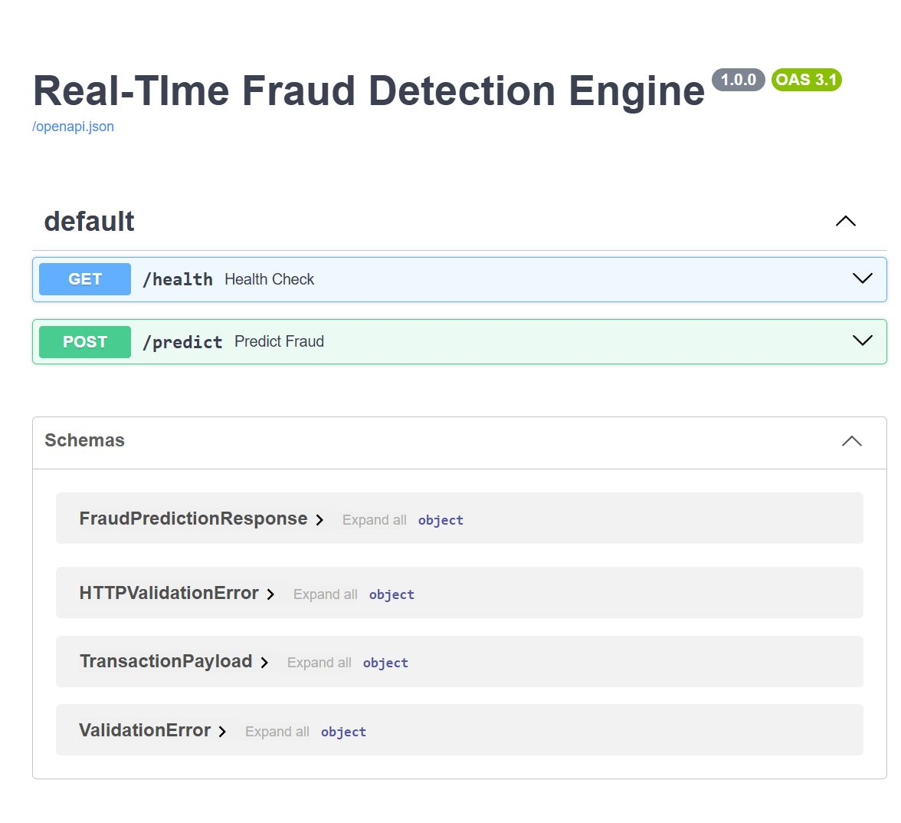
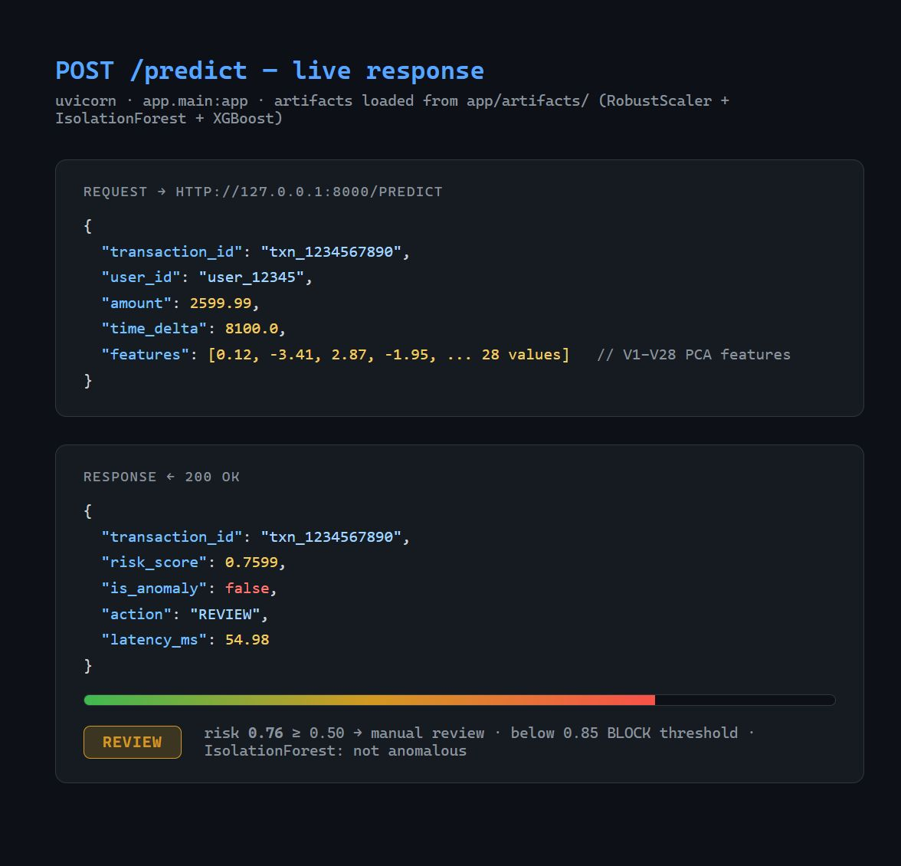
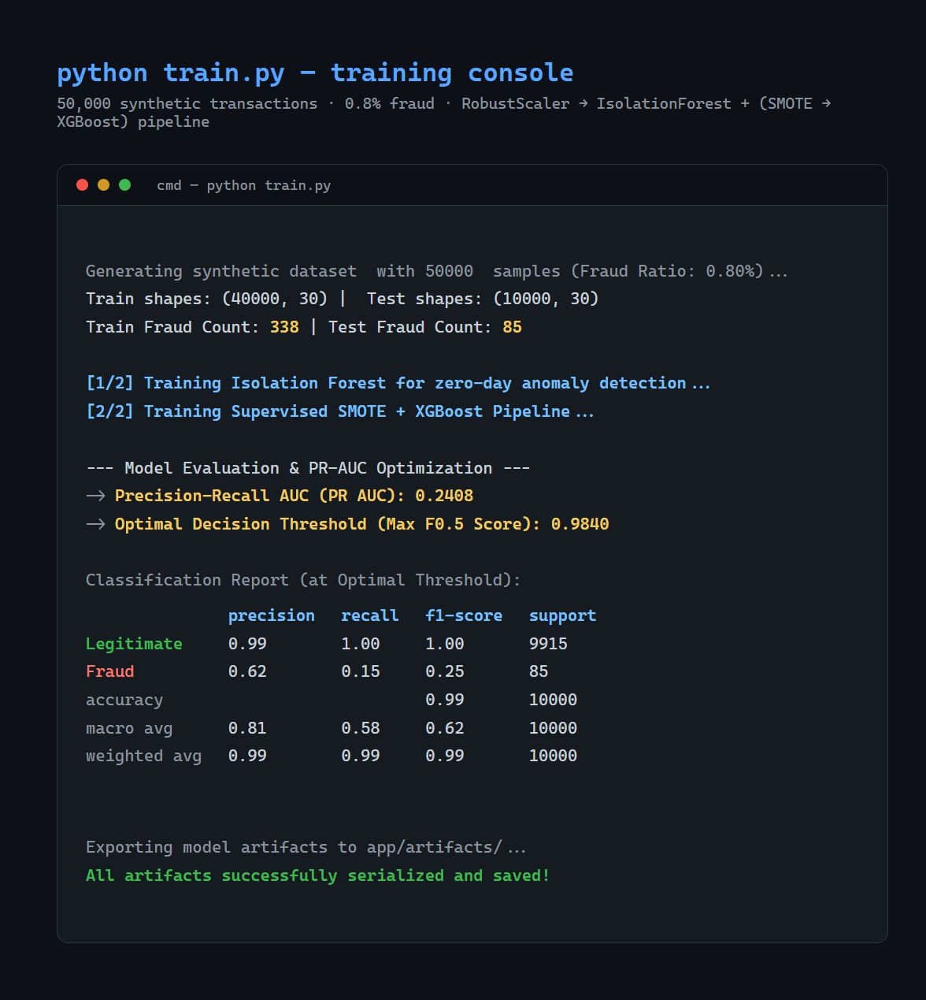

# Real-Time Fraud Detection Engine 💳

An end-to-end machine learning pipeline that spots fraudulent credit card transactions as they happen. You send it a transaction, it sends you back a risk score and a clear action: **ALLOW**, **REVIEW**, or **BLOCK**.

The interesting part of this project isn't just "a model that predicts fraud" — it's dealing with the reality of fraud detection: **out of thousands of transactions, less than 1% are actually fraudulent**. This pipeline attacks that problem from two angles at once.

## The Two-Layer Approach

Most fraud systems only look at known patterns. This one doesn't:

| Layer | Model | What it catches |
|-------|-------|-----------------|
| 🧠 Supervised | SMOTE + XGBoost | Known fraud patterns learned from labeled data |
| 🔍 Unsupervised | Isolation Forest | "Zero-day" fraud — weird transactions that don't match anything seen before |

Even if a new type of fraud has never been labeled in the training data, the Isolation Forest can still flag it as anomalous. The FastAPI service combines both signals into one decision.

## Why Precision Matters More Than Recall Here

Blocking a legit transaction annoys a real customer. Missing a fraud costs money. Both matter, so the training script tunes the decision threshold using the **F0.5 score** (which leans toward precision) instead of plain accuracy — because accuracy is basically meaningless when 99% of transactions are legitimate. A dumb model that predicts "not fraud" every time would score 99% accuracy and catch zero fraud.

For the same reason, evaluation uses **Precision-Recall AUC (PR-AUC)** rather than ROC-AUC, which tends to look overly rosy on heavily imbalanced data.

## Project Structure

```
fraud-detection-pipeline/
├── train.py              # Data generation + model training + artifact export
├── app/
│   ├── main.py           # FastAPI service (prediction logic, decision rules)
│   ├── schema.py         # Pydantic request/response models
│   └── artifacts/        # Trained model files (generated by train.py)
├── tests/
│   └── locustfile.py     # Load testing with Locust
├── Dockerfile
└── requirements.txt
```

## Getting Started

### 1. Train the Model

```bash
pip install -r requirements.txt
python train.py
```

This generates 50,000 synthetic transactions (~0.8% fraud, mimicking the real-world imbalance), trains both models, evaluates them, and dumps the artifacts into `app/artifacts/`:

- `robust_scaler.joblib` — RobustScaler (robust to outlier amounts, which fraud data is full of)
- `iso_forest.joblib` — the unsupervised anomaly detector
- `model_meta.joblib` — the supervised XGBoost classifier

### 2. Serve Predictions

```bash
uvicorn app.main:app --reload
```

The API is now live at `http://localhost:8000`. Interactive docs are at `/docs`.

### 3. Send a Transaction

```bash
curl -X POST http://localhost:8000/predict \
  -H "Content-Type: application/json" \
  -d '{
    "transaction_id": "txn_1234567890",
    "user_id": "user_12345",
    "amount": 110.50,
    "time_delta": 3600.0,
    "features": [0.1, -0.2, 0.3, 0.0, 0.5, -0.1, 0.2, 0.3,
                 -0.4, 0.1, 0.0, 0.2, -0.3, 0.6, 0.1, -0.2,
                 0.3, 0.1, 0.0, -0.1, 0.2, 0.4, -0.3, 0.1,
                 0.2, -0.1, 0.3, 0.1]
  }'
```

The `features` array carries 28 PCA-style features (V1–V28, like the classic Kaggle credit card dataset), plus `amount` and `time_delta` sent explicitly.

Response:

```json
{
  "transaction_id": "txn_1234567890",
  "risk_score": 0.87,
  "is_anomaly": true,
  "action": "BLOCK",
  "latency_ms": 3.42
}
```

How the decision gets made:

| Risk score | Anomaly flag | Action |
|-----------|--------------|--------|
| ≥ 0.85 | — | 🔴 BLOCK |
| ≥ 0.50 *or* Isolation Forest flagged it | — | 🟡 REVIEW |
| anything else | — | 🟢 ALLOW |

### 4. Run with Docker

```bash
docker build -t fraud-detection-api .
docker run -p 8000:8000 fraud-detection-api
```

### 5. Load Test It

Want to know how the API holds up under transaction spikes?

```bash
locust -f tests/locustfile.py --host http://localhost:8000
```

The Locust script simulates a realistic transaction stream with randomized amounts and timing, with a 10–50ms think time between requests per user.

## Screenshots

Real captures from a live run of this repo (model trained, API served, load test executed):

**1. Interactive API docs** — Swagger UI with `/health` and `/predict` live:



**2. A live prediction** — one real transaction scored end-to-end by the serialized scaler + Isolation Forest + XGBoost:



**3. Training run** — `python train.py` output with PR-AUC, F0.5-optimized threshold and the classification report:



To reproduce the screenshots yourself: run the steps above, open `http://localhost:8000/docs`, fire a `curl`, watch `python train.py`, and run `locust -f tests/locustfile.py --host http://localhost:8000` (open `http://localhost:8089` for the charts).

## A Few Honest Notes

- The dataset here is **synthetic** (generated with `sklearn.datasets.make_classification`). The feature names and shapes echo the real Kaggle credit card fraud dataset, so you can swap in the real one down the line without changing the pipeline plumbing.
- If the service is started without trained artifacts, it falls back to generating a random risk score — handy for smoke testing, obviously not for production.
- The monoculture stack (single XGBoost model) is intentionally simple. A real system would add ensembling, drift monitoring, and a feedback loop from REVIEW decisions back into training data.

## Ideas for Next Steps

- [ ] Swap synthetic data for the real [Kaggle credit card fraud dataset](https://www.kaggle.com/datasets/mlg-ulb/creditcardfraud)
- [ ] Persist transactions to a database / message queue
- [ ] Add model drift monitoring
- [ ] CI with tests (health check, schema validation, decision rules)

---

*Built with Python, FastAPI, XGBoost, scikit-learn, and imbalanced-learn.*
